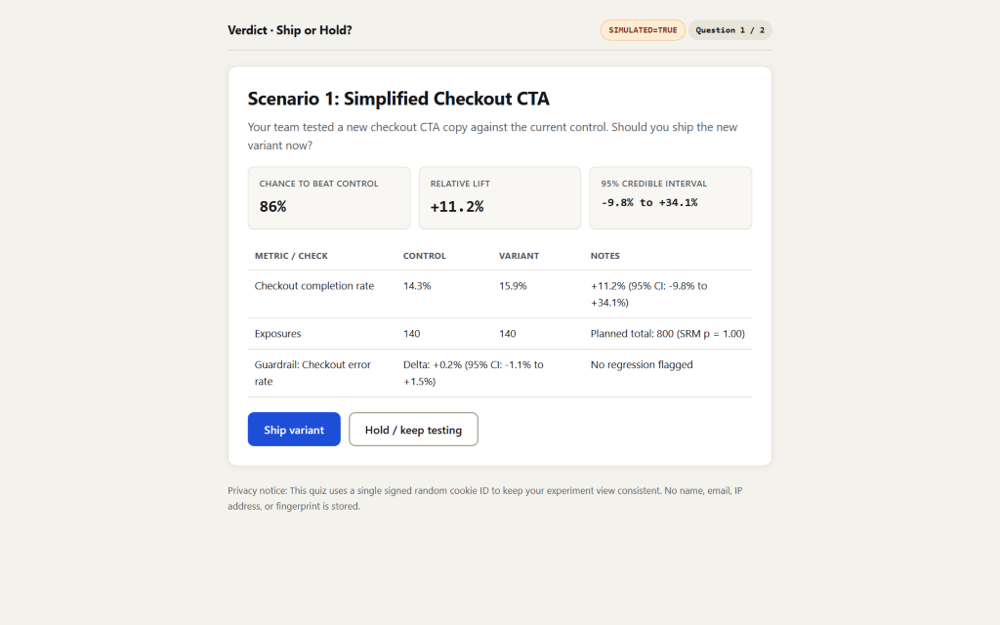
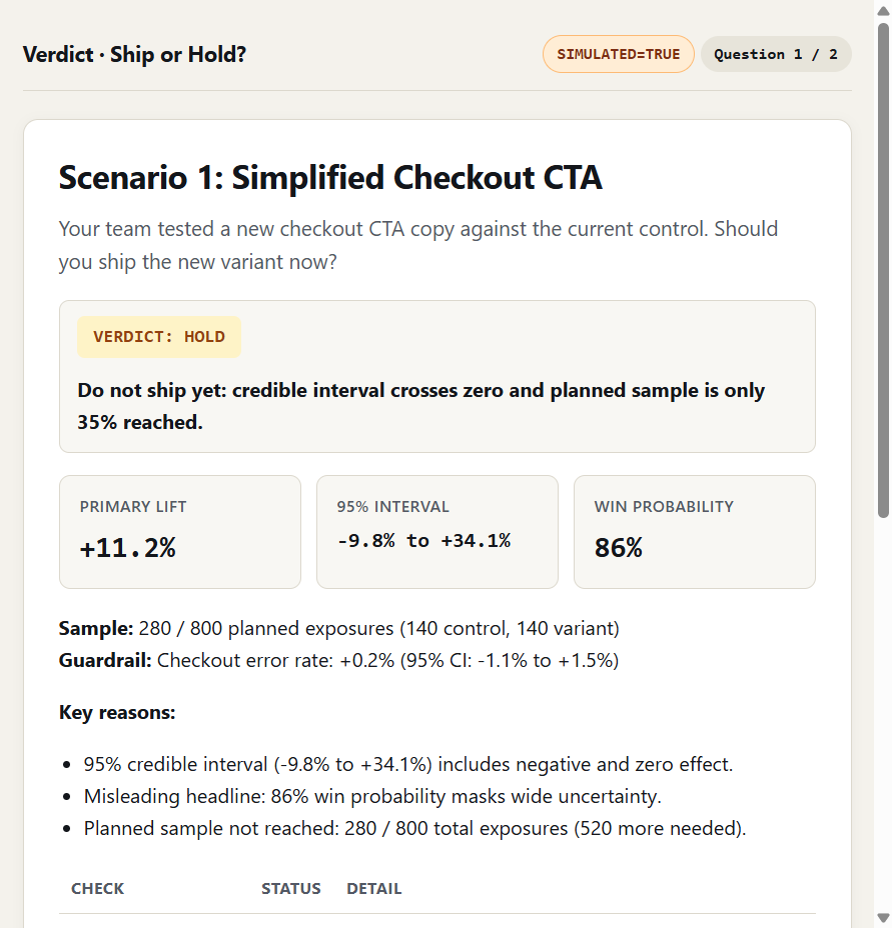
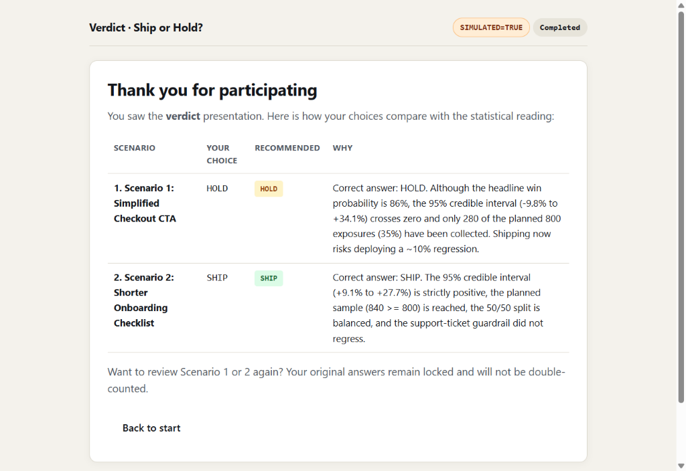
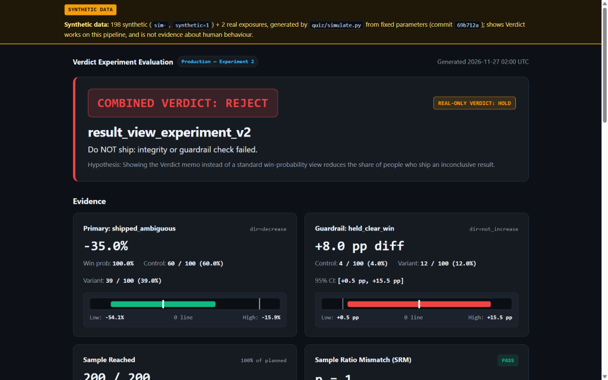
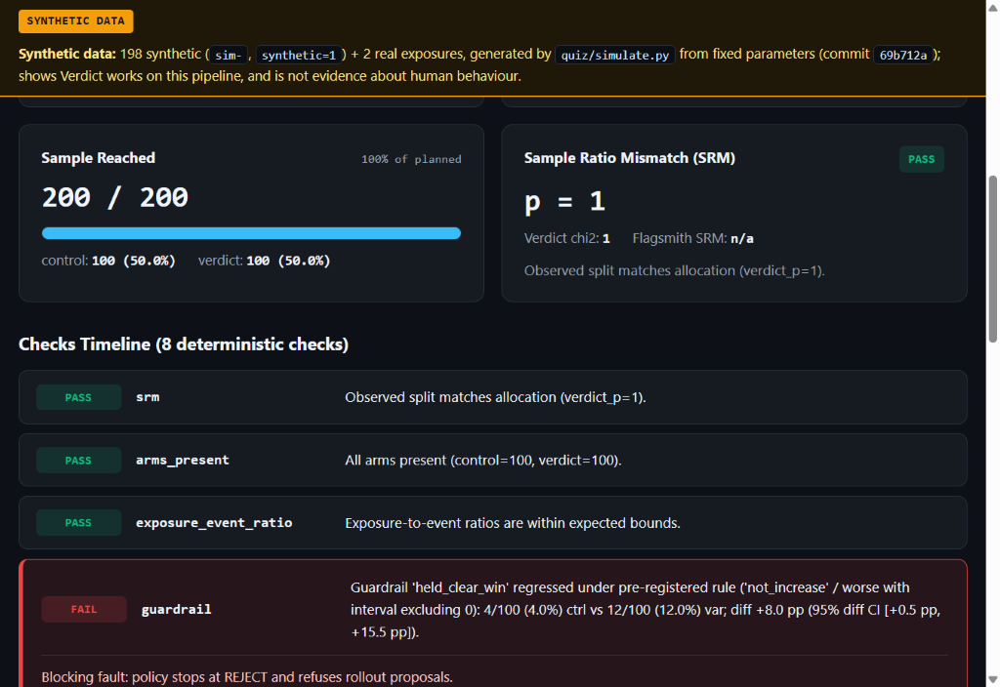
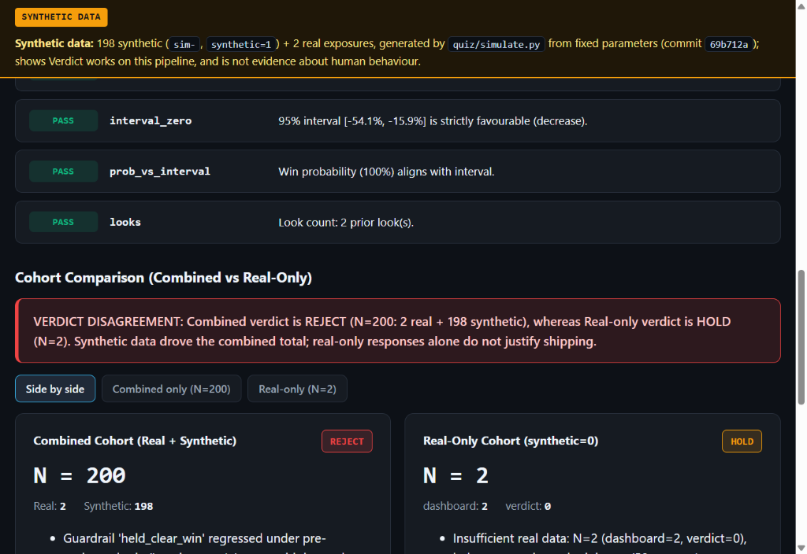
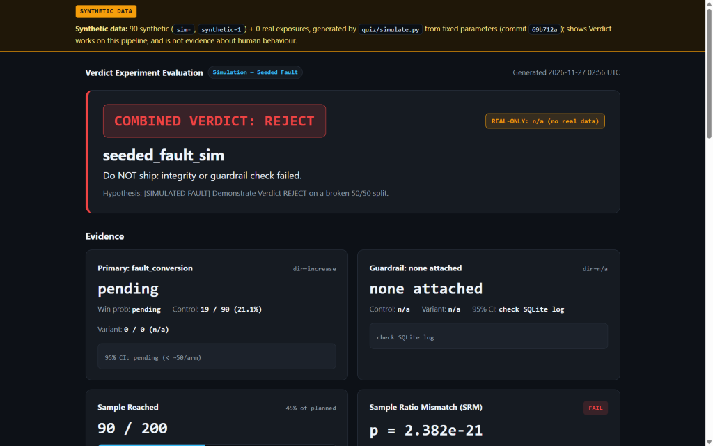
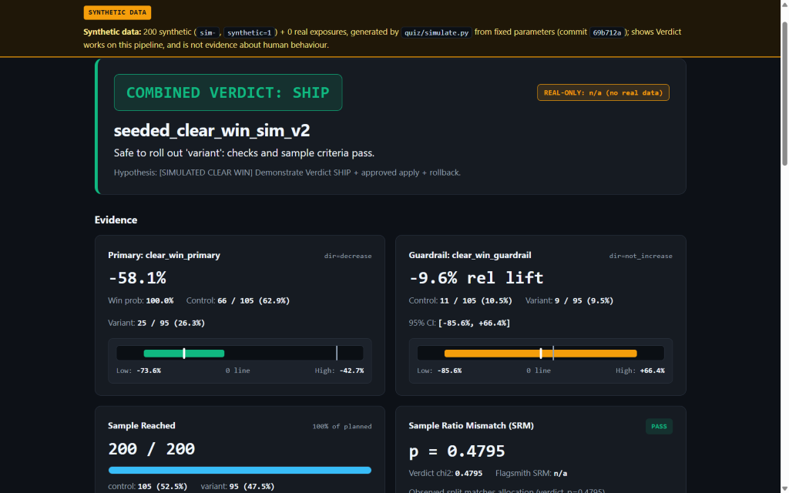
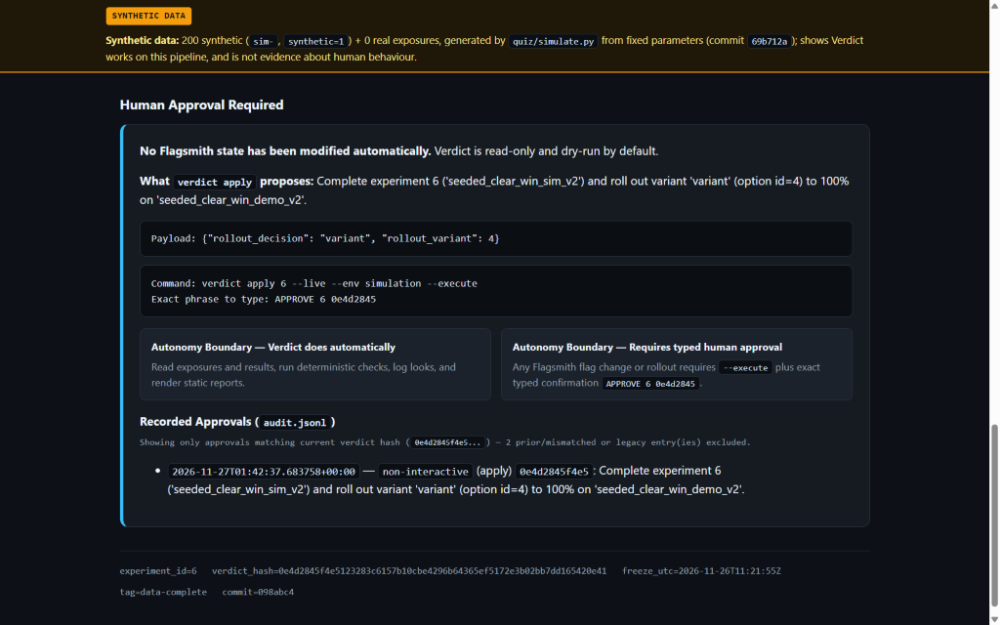

# Verdict

**An auditable experiment gatekeeper for Flagsmith: deterministic statistics, zero unapproved mutations, and an honest self-test.**

> Built for **Toggle Wars (WeMakeDevs × Flagsmith, Nov 26–29, 2026)** · Submitted to **Track 1 (Test Something Real)** & **Track 2 (AI Agents & Feature Flags)** · **$0 budget** (100% self-hosted OSS Flagsmith + FastAPI + SQLite + Python).

---

## The Problem: Dashboards Sell Noise as Certainty

Feature-flag dashboards routinely headline **"86% chance to beat control"** right next to a 95% credible interval that crosses zero (`-9.8%` to `+34.1%`). Faced with a big win probability:

1. Teams ship inconclusive variance (`HOLD` mistaken for `SHIP`).
2. Broken randomization (Sample Ratio Mismatch, missing arms, client drop-off) still shows a fake "winner."
3. Guardrails silently regress when low event counts suppress relative-lift intervals.
4. Autonomous "closed-loop" agents mutate live feature flags without human accountability.

**Verdict** is the deterministic second pair of eyes between Flagsmith analytics and production flag state.

---

## What Verdict Does (and Why It Beats Standard Approaches)

| Failure Mode | Typical Dashboard / LLM Agent | Verdict |
|---|---|---|
| **Math reliability** | LLM hallucinates statistics or reads raw win % | **100% deterministic Python** (`verdict/checks.py`, `verdict/policy.py`); LLM is disabled (`VERDICT_LLM=off`) and never decides `SHIP`/`HOLD`/`REJECT` |
| **Misleading headlines** | Headlines `"86% chance to win"` even when CI spans zero | Flags `prob_vs_interval` (`WARN`) and blocks rollout (`HOLD`) until 95% CI excludes zero **and** planned sample is met |
| **Missing guardrail CI** | Ignores guardrail when events `< 5` and returns `PASS` | Computes a 95% difference-in-proportions CI when `N >= 50/arm`, `HOLD`s when `< 50/arm` (never auto-`PASS`es unavailable intervals) |
| **Broken randomization** | Shows lift/winner despite 90/0 or 85/15 split | Cross-checks Flagsmith `srm_p_value` with chi-square goodness-of-fit (`p < 0.001`) and `arms_present` → **`REJECT`** |
| **Peeking bias** | Silently lets PMs stop early on a lucky peek | Tracks every effect look in `data/looks.jsonl` (`kind="effect"`), separate from `kind="integrity"` health checks |
| **Unsafe flag writes** | Auto-promotes winning variants | **Dry-run by default**; refuses non-`SHIP`; requires typed `APPROVE <id> <hash8>`, checks pre-write state drift, logs to `data/audit.jsonl`, supports typed `verdict rollback` |
| **Synthetic vs real mixing** | Blends test bots into headline numbers | Separates `real` (`synthetic=0`) vs `synthetic` (`sim-`), shows both verdicts side by side, and flags any `DISAGREEMENT` |

---

## Architecture & Flagsmith Integration

```text
  Visitors ──▶ FastAPI Quiz (:3000) ──SDK evaluate + events──▶ Flagsmith OSS (:8000)
                    │                                                  ▲
               SQLite log                                      Management REST API
             (real vs sim-)                                        (RestClient)
                    └──────────────▶ Verdict CLI & Report ◀────────────┘
                                       │   checks.py → policy.py → memo.py
                                       │   looks.jsonl · audit.jsonl · results.html
                                       └──▶ verdict apply / rollback (--dry-run default)
                                            requires typed APPROVE / ROLLBACK + drift check
```

**Flagsmith features used:**
- **Self-hosted OSS Flagsmith (`docker/docker-compose.yml`):** Flagsmith API/UI (`:8000`) + PostgreSQL analytics warehouse (`EXPERIMENTATION_ENABLED='true'`, `USE_POSTGRES_FOR_ANALYTICS='true'`).
- **Multivariate Feature Flags:** `result_view` (`dashboard` vs `verdict`, 50/50 split) in Production; isolated sandbox flags (`seeded_fault_demo`, `seeded_clear_win_demo_v2`) in Simulation.
- **Experimentation (A/B tests):** Exposure & conversion tracking (`Occurrence` metrics `shipped_ambiguous` and `held_clear_win`), on-demand exposure/results refresh, and `srm_p_value`.
- **Management REST API (`RestClient`):** All live reads (`get_experiment`, `get_exposures`, `get_results`) and human-approved writes (`complete/`, `featurestates/` rollback) go through Flagsmith's REST API, with `FixtureClient` for offline evaluation/tests. *(Note: `scripts/g1_check.py` includes a Gate G1 probe against Flagsmith's optional MCP endpoint, but Verdict itself does not use MCP.)*

- **Track 2 (`verdict/`)**: Audits Flagsmith experiments (`RestClient` or `FixtureClient`), renders dark high-contrast static reports (`scripts/render_results.py`) and Rich CLI panels (`verdict/rich_ui.py`), and gates every flag mutation behind human typed approval (`human-typed` only when running interactively on a TTY; `non-interactive` otherwise).
- **Track 1 (`quiz/` + `docs/EXPERIMENT.md`)**: A live 2-scenario **"Ship or Hold?"** quiz behind Flagsmith multivariate flag `result_view` (`dashboard` vs `verdict`, 50/50 split) testing whether showing Verdict's decision memo reduces premature shipping (`shipped_ambiguous`) without causing false caution on clear wins (`held_clear_win`).

---

## Deterministic Decision Policy (`verdict/policy.py`)

Evaluated strictly top-to-bottom; **first match wins**:

1. **Integrity `FAIL`** (`srm` `p < 0.001` at adequate N, missing exposure arm at adequate N, event/exposure anomaly) → **`REJECT`** *(do not ship; fix tracking)*
2. **Guardrail `FAIL`** (guardrail interval strictly worse and excluding `0`) → **`REJECT`** *(do not ship; guardrail regressed)*
3. **`HOLD` condition** (`sample_reached` unmet, primary `interval_zero` crosses zero/pending, or guardrail interval unavailable `< 50/arm`) → **`HOLD`** *(keep collecting data)*
4. **All checks pass** (CI strictly favourable, planned sample reached, SRM & guardrail clean) → **`SHIP`** *(propose rollout, wait for typed human approval)*

---

## Live Verification & Honest Results

> **Synthetic Data Disclosure:** Production Experiment `2` (`result_view_experiment_v2`, freeze `2026-11-26T11:21:55Z`, tag `data-complete`) contains **200 total exposures: 2 real + 198 synthetic** (`sim-` prefix, `synthetic=1`) generated by [`quiz/simulate.py`](quiz/simulate.py) from pre-committed parameters (`commit 69b712a`). It proves the end-to-end pipeline works under realistic noise and is **not** evidence about human behaviour.

### What Happened on Production Experiment `2` (`result_view_experiment_v2`)

Even though the primary metric looked like a slam dunk (`-35.0%` lift, `95% CI [-54.1%, -15.9%]`, **100% win probability**), **Verdict returned `REJECT`**:
- Flagsmith suppressed the guardrail interval because control had `< 5` conversions (`4/100`).
- Verdict's difference-in-proportions check caught the regression (`4/100` `4.0%` vs `12/100` `12.0%`; `+8.0 pp`, `95% diff CI [+0.5 pp, +15.5 pp]`) and blocked rollout.
- Meanwhile, the **Real-only cohort (`N=2`)** honestly returned **`HOLD`** (below the pre-registered minimum of `50/arm`), triggering a **`VERDICT DISAGREEMENT`** callout.

### Simulation Demonstrations (Local Flagsmith Sandbox)
- **Seeded SRM Fault (`seeded_fault_sim`)**: Skewed traffic (`srm` `p < 0.001`, missing `variant` exposures) → **`REJECT`** (`verdict apply` refuses to propose changes).
- **Clear Win + Human Approval + Rollback (`seeded_clear_win_sim_v2`)**: `N=200` (`105` ctrl / `95` var), primary `-58.1%` (`[-73.6%, -42.7%]`), guardrail `-9.6%` (`[-85.6%, +66.4%]`) → **`SHIP`** → approved with typed `APPROVE 6 <hash8>` (promoted variant to `100%`, logged to `audit.jsonl`) → rolled back to `100%` control via typed `ROLLBACK 6 seeded_clear_win_demo_v2`.

---

## Autonomy Boundary

| Verdict does automatically | Verdict NEVER does without typed human approval |
|---|---|
| Read Flagsmith exposures & results | Complete or stop an experiment |
| Run 8 deterministic statistical & integrity checks | Change rollout weights or feature values |
| Log peeking looks & export anonymised CSVs | Promote a winning variant to 100% |
| Render Rich CLI memos & static HTML reports | Roll back a feature state |

---

## Visual Walkthrough

### 1. Track 1 Quiz: Standard Dashboard vs Verdict Memo (`result_view` A/B test)

Visitors randomized to **`dashboard`** see a tempting `"86% Chance to Beat Control"` headline next to a zero-crossing interval (`-9.8% to +34.1%`). Visitors randomized to **`verdict`** see the deterministic **`VERDICT: HOLD`** memo with explicit reasons before choosing **Ship** or **Hold**.

| Control Arm (`dashboard`) — The 86% Trap | Treatment Arm (`verdict`) — Deterministic HOLD Memo |
|---|---|
|  |  |

<details>
<summary>Completion screen (<code>/done</code>): immediate feedback comparing respondent choices vs statistical reading</summary>



</details>

### 2. Verdict Results Report — Production Experiment `2` (`REJECT` on Guardrail Regression)

Even with `-35.0%` primary lift and `100%` win probability, Verdict blocks rollout because `held_clear_win` regressed from `4/100` (`4.0%`) to `12/100` (`12.0%`) (`+8.0 pp`, `95% diff CI [+0.5 pp, +15.5 pp]`), and flags the `VERDICT DISAGREEMENT` against the underpowered real-only cohort (`N=2`, `HOLD`).



| Guardrail Regression Caught in Checks Timeline | Combined vs Real-Only Cohort Disagreement |
|---|---|
|  |  |

### 3. Simulation Paths — Seeded SRM Fault (`REJECT`) & Clear Win (`SHIP` + Typed Approval + Audit Log)

| Seeded SRM Fault (`seeded_fault_sim` → `REJECT`) | Clear Win (`seeded_clear_win_sim_v2` → `SHIP`) |
|---|---|
|  |  |



---

## Quickstart

### 1. Install (Python 3.11+)
```bash
python -m venv .venv
# Windows PowerShell: .venv\Scripts\Activate.ps1
# Linux/macOS:        source .venv/bin/activate
pip install -e ".[quiz,dev,cli]"
```

### 2. Run Offline Immediately (Zero Network, Zero Keys)
```bash
pytest -q                              # 55 deterministic tests
ruff check verdict quiz scripts tests  # lint clean

# Evaluate all 6 offline scenario fixtures
verdict check ship --fixture
verdict check hold --fixture
verdict check reject_srm --fixture
verdict check reject_guardrail --fixture
verdict apply ship --fixture           # dry-run proposal (never writes)
```

### 3. Run Self-Hosted Flagsmith + Quiz + Live Checks

Copy `.env.example` to `.env` and set values locally (never commit `.env`). Required environment variable names:
- **Flagsmith connection & auth:** `FLAGSMITH_URL`, `FLAGSMITH_API_KEY`, `FLAGSMITH_ENV_KEY`, `FLAGSMITH_EXPERIMENT_ID`
- **Isolated Simulation sandbox:** `FLAGSMITH_SIM_ENV_KEY`, `FLAGSMITH_SIM_EXPERIMENT_ID`
- **Quiz & LLM controls:** `QUIZ_COOKIE_SECRET`, `QUIZ_SIMULATED_MODE`, `QUIZ_SYNTHETIC_TOKEN`, `VERDICT_LLM` (`off` by default)
- **Optional Gate G1 probe only:** `FLAGSMITH_MCP_URL`

```bash
# Start self-hosted Flagsmith OSS (:8000 API/UI + PostgreSQL analytics warehouse)
docker compose -f docker/docker-compose.yml up -d

# Start the Track 1 quiz (in simulated mode or configured .env)
uvicorn quiz.app:app --port 3000

# Simulation demonstrations (safe sandbox only)
python -m scripts.seed_fault --env simulation
verdict check seeded_fault_sim --live --env simulation --refresh   # -> REJECT

python -m scripts.seed_ship --env simulation
verdict check seeded_clear_win_sim_v2 --live --env simulation --refresh  # -> SHIP
verdict apply seeded_clear_win_sim_v2 --live --env simulation            # dry-run
verdict apply seeded_clear_win_sim_v2 --live --env simulation --execute  # interactive APPROVE
verdict rollback seeded_clear_win_sim_v2 --live --env simulation --execute

# Render dark 1080p static HTML report
python -m scripts.render_results ship --fixture --out data/export/ship.html
```

---

## Known Limitations

- **Mostly synthetic dataset:** Production Experiment `2` (`result_view_experiment_v2`) has `2` real exposures and `198` synthetic exposures (`sim-` prefix, `synthetic=1`) generated from fixed parameters (`commit 69b712a`). It validates the pipeline end-to-end and is **not** evidence about human decision behaviour; real-only (`N=2`) is reported honestly as `HOLD`.
- **No multiplicity / sequential alpha adjustment:** Multiple experiments or metrics are evaluated individually without Bonferroni/FDR correction, though premature effect looks before reaching planned sample trigger a `looks` `WARN`.
- **Guardrail interval rule updated after first look:** On the first post-freeze evaluation (`4/100` vs `12/100`), Flagsmith suppressed the guardrail interval (`< 5` control events). Verdict was updated to compute a 95% difference-in-proportions CI (`>= 50/arm`) and `HOLD` on unavailable intervals (`< 50/arm`) using the pre-registered `not_increase` rule without inventing a new numeric margin (documented in [`docs/EXPERIMENT.md`](docs/EXPERIMENT.md)).
- **Ephemeral quick-tunnel hostname:** Public hosting uses a $0 Cloudflare Quick Tunnel (`trycloudflare.com`), whose hostname rotates if the tunnel process or host reboots (mitigated by the static redirect page, though returning visitors lose origin-scoped cookies across URL rotations).

---

## Repository Map

| Path | Purpose |
|---|---|
| [`verdict/`](verdict/) | Core package: `checks.py`, `policy.py`, `cohort.py`, `memo.py`, `rich_ui.py`, `cli.py`, `client/` (`FixtureClient`, `RestClient`), `templates/results.html` |
| [`quiz/`](quiz/) | Track 1 FastAPI + Jinja2 quiz (`app.py`, `db.py`, `flagsmith_sdk.py`, `security.py`, `simulate.py`, `static/style.css`) |
| [`scripts/`](scripts/) | `seed_fault.py`, `seed_ship.py`, `render_results.py`, `export_csv.py`, `health.py`, `status.py` |
| [`data/fixtures/`](data/fixtures/) | Offline experiment snapshots (`ship`, `hold`, `hold_insufficient_data`, `reject_srm`, `reject_guardrail`, `peeking`) |
| [`docs/`](docs/) | [`EXPERIMENT.md`](docs/EXPERIMENT.md), [`PRD.md`](docs/PRD.md), [`ARCHITECTURE.md`](docs/ARCHITECTURE.md), [`FLAGSMITH_NOTES.md`](docs/FLAGSMITH_NOTES.md), [`RUNBOOK.md`](docs/RUNBOOK.md), [`DEMO.md`](docs/DEMO.md) |
